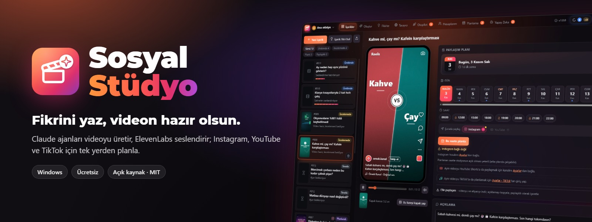
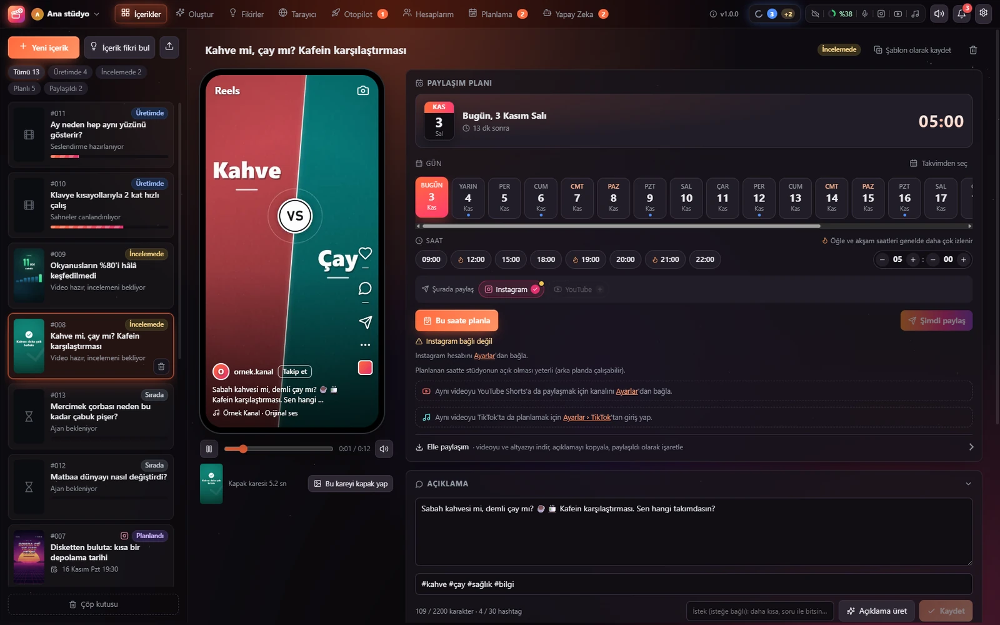
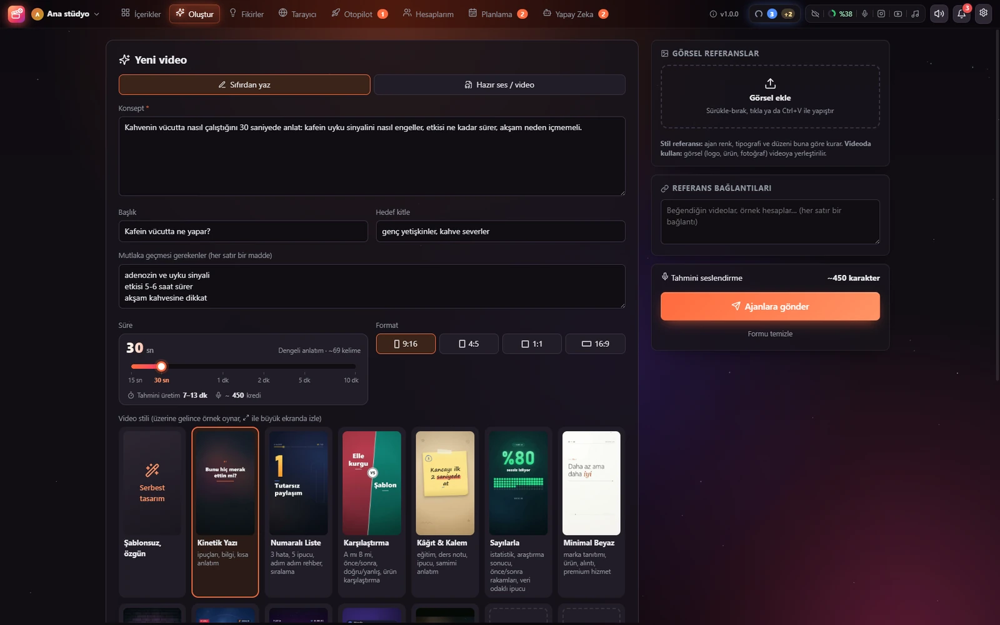
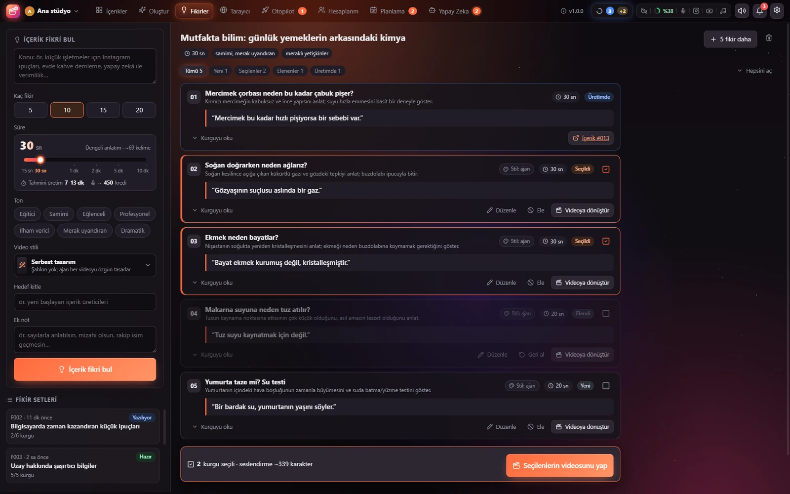
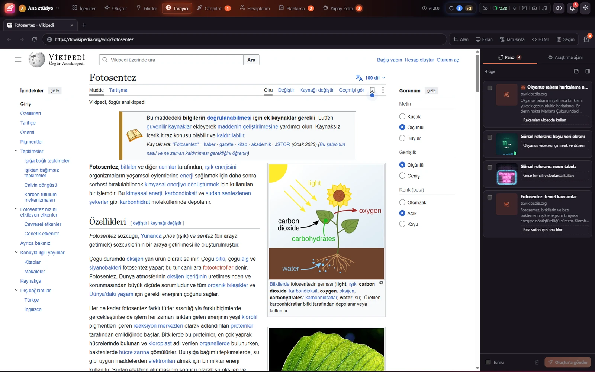
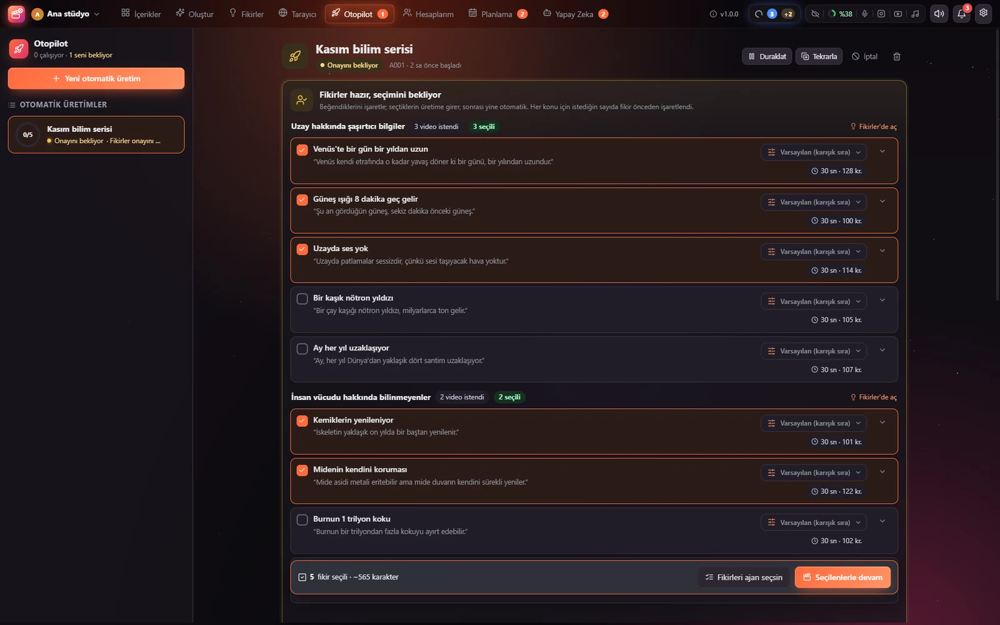
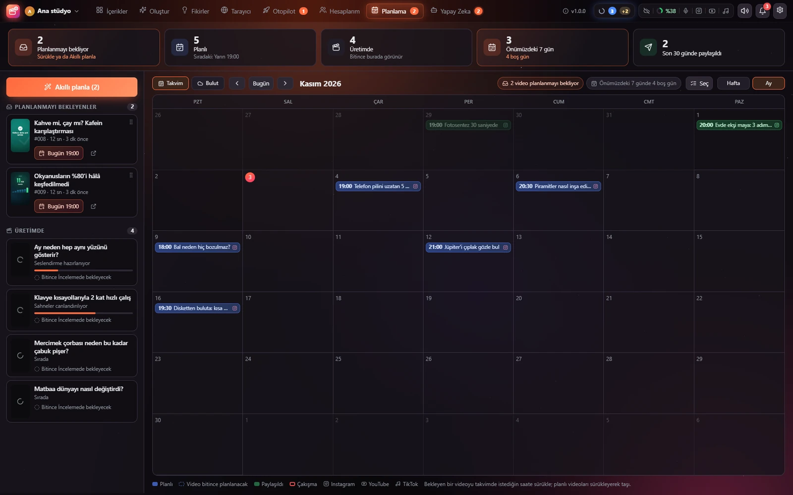
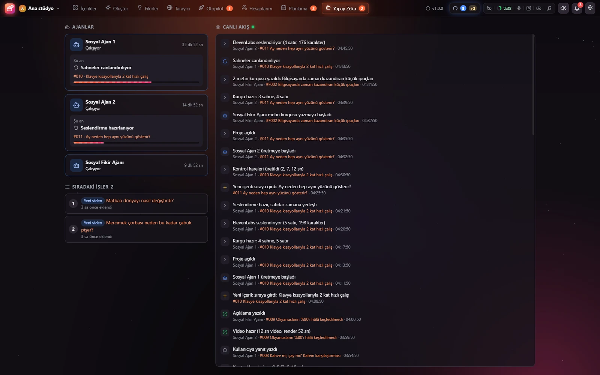
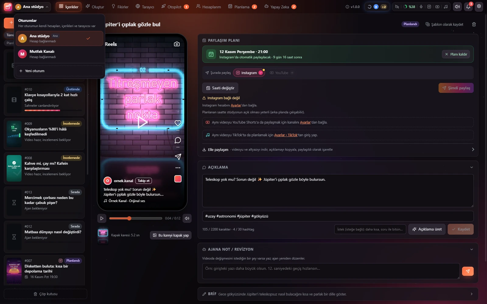

  

  <a href="https://www.bertadev.com/sosyal-studyo"><b>Web sitesi</b></a> ·
  <a href="https://github.com/BerTaDev/SosyalStudyo/releases/latest/download/SosyalStudyo-Kurulum.exe"><b>İndir (Windows)</b></a> ·
  <a href="https://github.com/BerTaDev/SosyalStudyo/releases">Sürümler</a> ·
  <a href="#kurulum-rehberleri">Kurulum rehberleri</a>

> **English:** Sosyal Stüdyo is a free, source-available Windows app for short-form social video, licensed under CC BY-NC-SA 4.0 (you may modify and share it non-commercially, under the same license). You write an idea; Claude Code agents script, animate, narrate (ElevenLabs) and subtitle it; you review it in a phone preview and schedule it for Instagram, YouTube Shorts and TikTok. Includes idea batches, a research browser with a research agent, autopilot campaigns, a calendar, account views and optional Cloudflare cloud publishing. The interface is in Turkish. Everything runs and stays on your PC, with no telemetry.

# Sosyal Stüdyo

Sosyal Stüdyo, kısa video üretimini ve paylaşımını tek pencerede toplayan, Windows için ücretsiz ve kaynak kodu açık bir masaüstü uygulamasıdır. Konseptini yazarsın; **Claude ajanları** metni yazar, sahneleri canlandırır, **ElevenLabs** ile seslendirir ve altyazıyı ekler. Sen videoyu telefon önizlemesinde inceler, gerekirse ajana not bırakır, sonra **Instagram, YouTube Shorts ve TikTok** için planlarsın.

## Özellikler

- **Oluştur:** konseptten video. 9:16, 1:1, 4:5 ve 16:9 formatları; 15 saniyeden 10 dakikaya süre; hazır video stilleri (kinetik yazı, numaralı liste, karşılaştırma, kâğıt ve kalem, sayılarla, minimal, neon, son dakika, retro, sohbet, sinematik fragman) ya da ajanın serbest tasarımı. ElevenLabs seslendirme ve kelime kelime vurgulanan altyazı. Hazır ses ya da video yüklersen konuşma otomatik yazıya dökülür.
- **İçerikler:** her video telefon önizlemesinde. Açıklama ve hashtag üret, ajana revizyon notu bırak, işlem geçmişini gör, altyazıyı SRT ya da VTT olarak indir.
- **Fikirler:** bir konu yaz, ajan kancası, sahneleri ve seslendirme metniyle fikir seti hazırlasın; seç, ele, üretime gönder.
- **Tarayıcı:** stüdyonun içinde gerçek bir tarayıcı. Ekran görüntüsü, metin ya da sayfayı araştırma panosuna at; araştırma ajanına görev ver; pano öğelerini videoya ekle.
- **Otopilot:** konuları, video sayısını, stilleri ve paylaşım saatlerini belirle; fikirler istenir, istersen onayın beklenir, videolar üretilip takvime yerleşir.
- **Planlama:** aylık takvim; sürükle bırak ile saat değiştir, çakışmaları gör.
- **Hesaplarım:** Instagram gönderileri, yorumlar, mesajlar ve istatistikler; YouTube kanalın ve TikTok hesabın.
- **Yapay Zeka:** ajanların ne yaptığını, sıradaki işleri ve canlı akışı izle; Claude kullanım limitini takip et, modeli ve efor düzeyini seç.
- **Oturumlar:** farklı hesaplar için birbirinden ayrı stüdyolar; sol üstteki seçiciden geç.
- **Bulut yayın:** ücretsiz Cloudflare hesabınla Instagram paylaşımları bilgisayarın kapalıyken de saatinde çıkar.
- **Bildirimler ve temalar:** video hazır, ajan yanıtı, paylaşım bildirimleri; yedi tema.

## Ekran görüntüleri

| | |
|---|---|
|  |  |
| **İçerikler:** önizleme, açıklama, ajana notlar | **Oluştur:** konsept, format, süre, stil |
|  |  |
| **Fikirler:** metin kurgularıyla fikir seti | **Tarayıcı:** araştırma panosu ve ajanı |
|  |  |
| **Otopilot:** kampanya ve fikir onayı | **Planlama:** takvim |
|  |  |
| **Yapay Zeka:** ajanlar ve canlı akış | **Oturumlar:** ayrı stüdyolar arasında geçiş |

Daha fazlası [web sitesinde](https://www.bertadev.com/sosyal-studyo#ekranlar).

## İndir

- **Kurulum dosyası:** [SosyalStudyo-Kurulum.exe](https://github.com/BerTaDev/SosyalStudyo/releases/latest/download/SosyalStudyo-Kurulum.exe) (her zaman son sürüm)
- **Tüm sürümler:** [github.com/BerTaDev/SosyalStudyo/releases](https://github.com/BerTaDev/SosyalStudyo/releases)
- **Web sitesi:** [bertadev.com/sosyal-studyo](https://www.bertadev.com/sosyal-studyo)

Kurulum dosyası dijital olarak imzalı değildir. Windows SmartScreen uyarı gösterirse **Ek bilgi** ve ardından **Yine de çalıştır**'a bas.

## Gereksinimler

- Windows 10 ya da 11, 64 bit
- Microsoft Edge (Windows'ta hazır gelir) ya da Google Chrome; videolar tarayıcı motoruyla render edilir
- Ajanlar için Claude aboneliği ve Claude masaüstü uygulaması (Claude Code)
- Seslendirme için ElevenLabs hesabı (başlamak için ücretsiz plan yeterli)
- İnternet bağlantısı; paylaşım için Instagram, YouTube ya da TikTok hesabı

## Hızlı başlangıç

1. Kurulum dosyasını indir ve çalıştır. Yönetici izni gerekmez.
2. Stüdyo ilk açılışta **Kurulum durumu** kartını gösterir: Node.js, ffmpeg, Playwright, konuşma tanıma modeli gibi eksik bileşenleri buradan tamamla.
3. **Ayarlar**'dan kullanacağın bağlantıları kur: ElevenLabs, Instagram, YouTube, TikTok, Cloudflare. Hepsi isteğe bağlıdır.
4. Claude masaüstü uygulamasında **Code** sekmesinden stüdyo klasöründe yeni bir oturum aç; stüdyonun üst çubuğundaki Claude göstergesinden kopyaladığın ajan metnini yapıştır. Ajan iş beklemeye başlar.
5. **Oluştur**'da ilk konseptini yaz ve gönder. İlerlemeyi **İçerikler** ve **Yapay Zeka** sekmelerinden izle.

## Claude ile kur

Bağlantı gerektiren her ekranda bir **Claude ile kur** düğmesi var. Düğme, o bağlantının kurulumunu adım adım anlatan hazır bir mesaj hazırlar. Mesajı Claude'a yapıştırırsın; Claude her seferinde tek adımı anlatır, İngilizce ekranlardaki düğme adlarını aynen söyler ve sen "tamam" dedikçe devam eder.

Şifreni, API anahtarını ya da token'ını Claude'a yazma. Bunları yalnızca stüdyodaki kendi kutularına sen yapıştırırsın; hazır mesaj da Claude'dan bunu ister.

## Kurulum rehberleri

| Rehber | Ne için |
|---|---|
| [Bileşenler](kurulum/bilesenler.md) | Node.js, ffmpeg, Playwright, konuşma tanıma |
| [Claude ajanları](kurulum/ajanlar.md) | Video ve fikir ajanlarını başlatma |
| [ElevenLabs](kurulum/elevenlabs.md) | Seslendirme |
| [Instagram](kurulum/instagram.md) | Paylaşım, yorumlar, mesajlar, istatistikler |
| [YouTube](kurulum/youtube.md) | YouTube Shorts |
| [TikTok](kurulum/tiktok.md) | TikTok'ta paylaşım ve planlama |
| [Cloudflare](kurulum/cloudflare.md) | Bilgisayar kapalıyken bulut yayın |

## Kaynaktan derleme

Stüdyo bir Python sunucusu (`server.py`), tarayıcı arayüzü (`web/`), video motoru (`engine/`) ve Electron masaüstü penceresinden (`desktop/`) oluşur. Kurulum dosyası `packaging/` klasöründeki betiklerle hazırlanır; gerekli araçlar ve adımlar o klasörde anlatılır.

## Gizlilik

- İçeriklerin, videoların ve ayarların bilgisayarındaki veri klasöründe durur.
- Stüdyo telemetri ya da kullanım verisi toplamaz.
- API anahtarları ve erişim izinleri yalnızca senin bilgisayarında saklanır ve sadece ilgili servise (ElevenLabs, Instagram, YouTube, TikTok, Cloudflare) bağlanmak için kullanılır.
- Bulut yayını açarsan planlı videolar senin kendi Cloudflare hesabına yüklenir.

## Lisans

Sosyal Stüdyo [CC BY-NC-SA 4.0](LICENSE) lisansıyla yayınlanır. © 2026 BerTaDEV

- **Geliştirip paylaşabilirsin:** Kodu değiştirebilir, kendi sürümünü yayınlayabilirsin. Sosyal Stüdyo'yu ve BerTaDEV'i kaynak olarak belirtmen gerekir.
- **Aynı lisansla:** Değiştirdiğin sürümü de CC BY-NC-SA 4.0 ile paylaşmalısın.
- **Ticari kullanım yok:** Sosyal Stüdyo'yu ya da ondan türettiğin bir sürümü satamaz, ticari bir ürünün ya da hizmetin parçası olarak dağıtamazsın.

Ayrıntılar için [lisans özeti](https://creativecommons.org/licenses/by-nc-sa/4.0/deed.tr). 1.0.0 sürümü MIT lisansıyla yayınlanmıştı; 1.0.1 ve sonrası CC BY-NC-SA 4.0 ile yayınlanır.

Üçüncü taraf bileşenler:

- [Lucide](https://lucide.dev) simgeleri: ISC lisansı, [web/LUCIDE_LICENSE](web/LUCIDE_LICENSE)
- [Montserrat](https://fonts.google.com/specimen/Montserrat) yazı tipi: SIL Open Font License 1.1, [fonts/OFL.txt](fonts/OFL.txt)
- [qrcode-generator](https://github.com/kazuhikoarase/qrcode-generator): MIT lisansı, [web/vendor/LICENSE-qrcode-generator.txt](web/vendor/LICENSE-qrcode-generator.txt)

Claude, Anthropic'in; ElevenLabs, Instagram, YouTube, TikTok ve Cloudflare kendi sahiplerinin ticari markalarıdır. Sosyal Stüdyo bu şirketlerle bağlantılı değildir.
